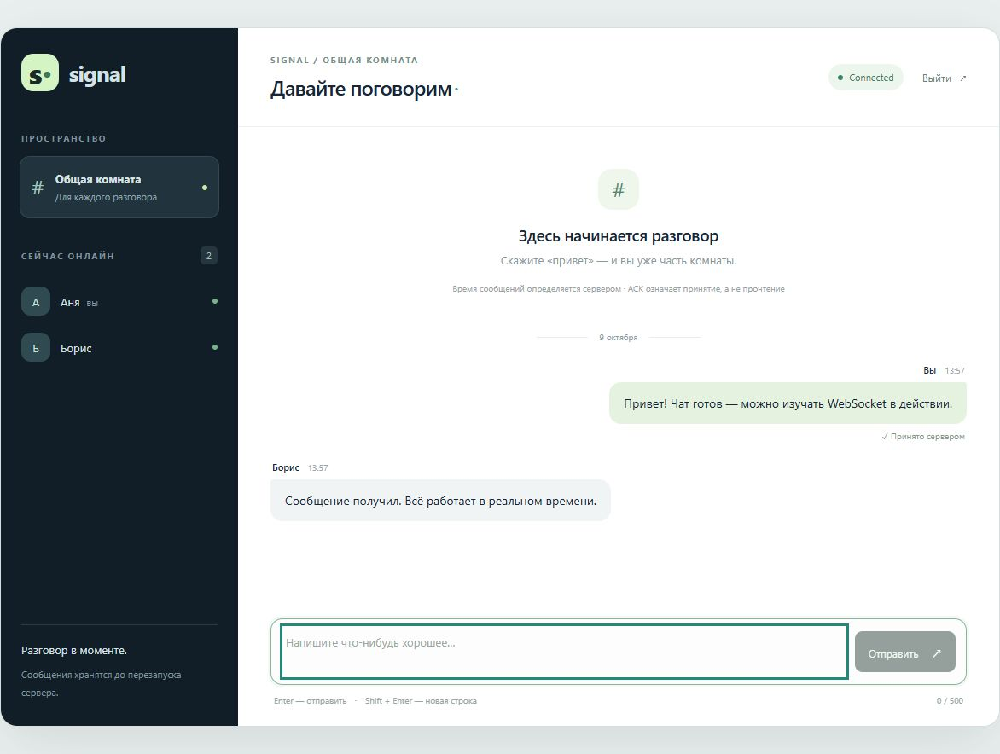
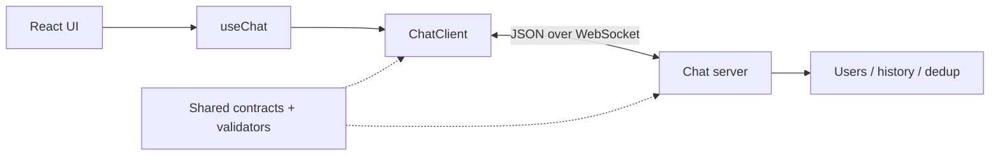
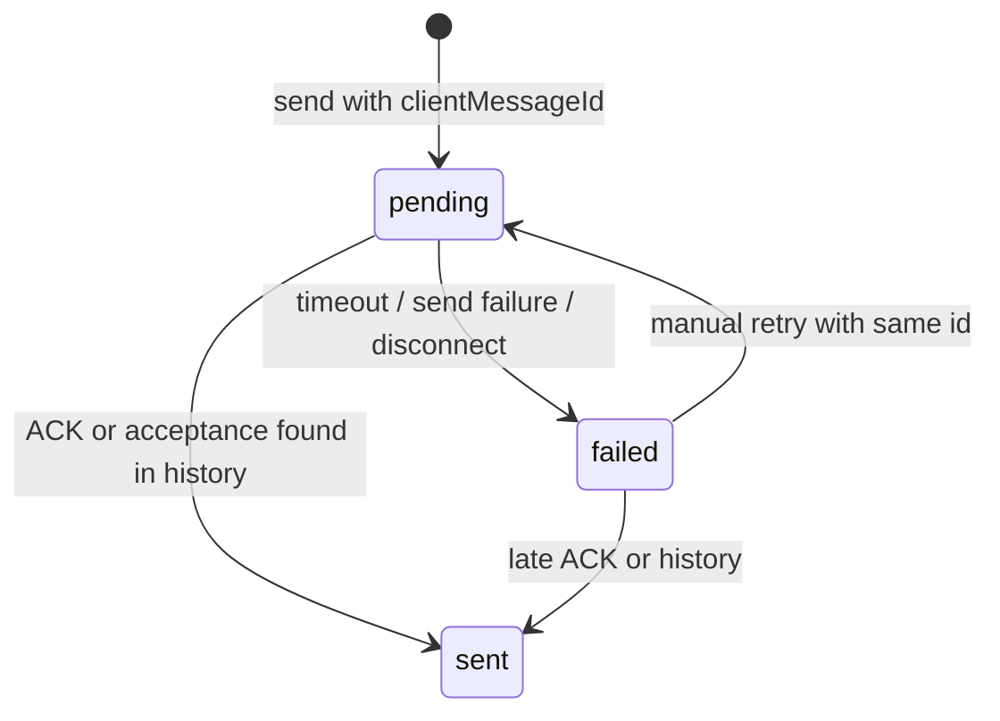

# Signal — Real-time Chat

Учебный многопользовательский чат с настоящим WebSocket-сервером, React и строгим TypeScript.



Все пять этапов опубликованы: основа и протокол, сервер, клиентская логика, интерфейс, тесты и документация.

## Project Overview

Пользователь вводит имя и входит в общую комнату. Сервер регистрирует подключение, передаёт историю и список участников. Сообщения и события набора текста приходят всем участникам в реальном времени. Все данные хранятся в памяти одного процесса.

## Features

- Вход по nickname, одинаковые имена разрешены.
- История последних 1000 сообщений, список онлайн-пользователей.
- Серверные UUID и время сообщений, текст до 500 символов.
- Enter для отправки, Shift + Enter для переноса строки.
- Connecting / Connected / Disconnected / Reconnecting.
- Автоматический reconnect с exponential backoff и jitter.
- Typing indicator с ограничением частоты и защитой от зависания.
- Pending / sent / failed, ACK и ручной retry без дубликатов.
- Runtime-валидация в обоих направлениях, безопасный вывод текста через React.
- Cleanup соединений, подписок и таймеров, поддержка React Strict Mode.
- Адаптивный интерфейс, панель участников на мобильных экранах.

## Tech Stack

| Слой     | Технологии                                             |
| -------- | ------------------------------------------------------ |
| Frontend | React 19, TypeScript, Vite 7, CSS Modules, React hooks |
| Backend  | Node.js, TypeScript, ws                                |
| Contract | @chat/shared, discriminated unions, ручные type guards |
| Tests    | Vitest, Testing Library, jsdom, настоящий ws-сервер    |
| Tooling  | pnpm workspace, Prettier, GitHub Actions               |

Точные версии зафиксированы в `pnpm-lock.yaml`.

## Architecture



UI отображает snapshot и вызывает методы клиента. Hook связывает независимый клиент с React через `useSyncExternalStore`. `ChatClient` владеет сокетом, reconnect, ACK-таймерами и состоянием. Сервер проверяет события, назначает время, хранит историю и рассылает изменения. Подробности и учебный маршрут: [ARCHITECTURE.md](docs/ARCHITECTURE.md).

## WebSocket Protocol

Endpoint: `/ws`. Каждый текстовый кадр содержит JSON с `type` и `payload`.

| Направление     | Событие                       | Payload                                        |
| --------------- | ----------------------------- | ---------------------------------------------- |
| Client → Server | `user:join`                   | `{ nickname, clientId }`                       |
| Client → Server | `message:send`                | `{ clientMessageId, text }`                    |
| Client → Server | `typing:start`, `typing:stop` | `{}`                                           |
| Server → Client | `user:join`                   | `{ id, nickname }` — подтверждение регистрации |
| Server → Client | `users:list`                  | `User[]`                                       |
| Server → Client | `message:history`             | `ChatMessage[]`                                |
| Server → Client | `message:new`, `message:ack`  | `ChatMessage`                                  |
| Server → Client | `typing:start`, `typing:stop` | `User`                                         |
| Server → Client | `error`                       | `{ code, message, clientMessageId? }`          |

```json
{
  "type": "message:send",
  "payload": {
    "clientMessageId": "605a92b7-4f43-4ee0-beb6-0b65708147a5",
    "text": "Привет!"
  }
}
```

`ChatMessage` содержит `id`, `clientMessageId`, `clientId`, `senderId`, `sender`, `text`, `timestamp`. Сервер назначает sender, senderId, серверный id и ISO-время. ClientId сохраняется при reconnect, senderId относится к одному соединению.

Невалидный JSON, неизвестное событие и неверный payload вызывают `error`. Бинарные кадры отклоняются. Кадр больше 8192 байт закрывает соединение с кодом 1009. Пустой текст и текст длиннее 500 символов запрещены; пробелы по краям удаляются после проверки длины.

## Connection Lifecycle

1. Вход создаёт клиент; эффект hook запускает connect.
2. WebSocket open вызывает отправку user:join.
3. Подтверждение регистрации переводит состояние в connected и разрешает отправку.
4. Сервер передаёт историю, список пользователей и активные typing-состояния.
5. Неожиданный close очищает online/typing, переводит pending в failed и запускает reconnect.
6. Выход или cleanup отменяет reconnect, закрывает сокет, отсоединяет handlers и очищает timers. React удаляет подписку.

Есть 10-секундный тайм-аут подключения/регистрации. Сервер закрывает незарегистрированное соединение через 10 секунд и проверяет ping/pong каждые 15 секунд.

## Reconnection Strategy

Задержки: 500 мс, 1 с, 2 с, 4 с, 8 с, 15 с; дальше — 15 с. Jitter выбирает 80–100% задержки, распределяя подключения во времени. Попытки не ограничены; счётчик сбрасывается после подтверждения регистрации.

Одновременно существует один текущий сокет и один reconnect-таймер. Повторный connect ничего не создаёт. Запоздалые callbacks старого сокета игнорируются. После reconnect nickname регистрируется повторно с прежним clientId; история и пользователи синхронизируются заново.

## Message Delivery



ACK означает принятие сервером, а не прочтение. Через 5 секунд без ACK сообщение становится failed: оно уже могло дойти, но подтверждения нет. Retry сохраняет clientMessageId.

Сервер хранит индекс `(clientId, clientMessageId)` для последних 5000 принятых сообщений. Повтор с тем же текстом и nickname получает исходный ACK без broadcast. Другой текст с тем же ключом вызывает ID_CONFLICT. ACK содержит полное сообщение для восстановления при потерянном message:new. Повторные события не создают дубликатов в интерфейсе.

История после reconnect подтверждает принятые сообщения с потерянным ACK. Failed-сообщения повторяются только по явному действию пользователя.

## Project Structure

```text
apps/client/src/
  App.tsx                # Переключение экранов входа и чата
  components/            # Отдельные UI-компоненты
  App.module.css         # Адаптивные стили
  hooks/useChat.ts       # React subscription and lifecycle
  hooks/useMessageScroll.ts # Прокрутка сообщений
  model/messageRows.ts   # Объединение серверных и исходящих сообщений
  utils/                 # Форматирование дат и WebSocket URL
  lib/ChatClient.ts      # Транспорт и состояние
  lib/DeliveryTracker.ts # Тайм-ауты ACK
  lib/types.ts           # Контракт транспорта и snapshot
apps/server/src/
  index.ts               # Запуск и завершение процесса
  server.ts              # Сборка и жизненный цикл сервера
  room.ts                # Связи между модулями комнаты
  handlers/              # Регистрация и принятие сообщения
  store/messageStore.ts  # История и дедупликация
  services/typing.ts     # Набор текста и его таймеры
  transport/             # HTTP, соединения, отправка событий, heartbeat
packages/shared/src/
  index.ts               # Протокол, пределы, runtime validators
docs/
  ARCHITECTURE.md         # Объяснение архитектуры
  VERIFICATION.md         # Проверки и ручные сценарии
.github/workflows/ci.yml  # Format, typecheck, tests, build
```

Тесты лежат рядом с кодом: `*.test.ts`.

## Getting Started

Требуется Node.js **22.13+** (рекомендуется **24 LTS**) и **pnpm 11.25.0**. Минимальная версия Node учитывает требования pnpm.

Если pnpm ещё не установлен:

```sh
npm install -g pnpm@11.25.0
```

Из корня проекта:

```sh
pnpm install --frozen-lockfile
pnpm dev
```

Откройте **http://127.0.0.1:5173/** в двух вкладках и введите имена. Frontend использует `/ws` через Vite proxy, backend слушает `127.0.0.1:3001`. Остановка — Ctrl+C. Занятый порт 5173 вызывает явную ошибку.

### Проверка production build

```sh
pnpm build
pnpm start
```

В другом терминале задайте прямой WebSocket-адрес, поскольку preview не использует development proxy, и пересоберите frontend:

```powershell
# Windows PowerShell, из корня проекта
$env:VITE_WS_URL = 'ws://127.0.0.1:3001/ws'
pnpm --filter @chat/client build
pnpm preview
```

```sh
# macOS / Linux, из корня проекта
VITE_WS_URL=ws://127.0.0.1:3001/ws pnpm --filter @chat/client build
pnpm preview
```

Preview открывается на **http://127.0.0.1:4173/**. Для размещения нужен reverse proxy: статика `apps/client/dist` и `/ws` → backend. С HTTPS используйте wss.

### Configuration

| Параметр    | По умолчанию          | Где задаётся                                    |
| ----------- | --------------------- | ----------------------------------------------- |
| PORT        | 3001                  | Окружение backend                               |
| HOST        | 127.0.0.1             | Окружение backend                               |
| VITE_WS_URL | /ws на текущем origin | Окружение при сборке или apps/client/.env.local |

При смене PORT обновите proxy в `vite.config.ts` либо задайте VITE_WS_URL. Backend не загружает `.env`: переменные передаются через терминал. Пример frontend-конфигурации — `apps/client/.env.example`. `GET http://127.0.0.1:3001/health` возвращает `{ "status": "ok" }`.

## Running Tests

```sh
pnpm typecheck
pnpm test
pnpm test:watch
pnpm format:check
pnpm build
```

Серверные тесты поднимают настоящий WebSocket-сервер на свободном порту. Unit-тесты клиента используют fake timers для reconnect и ACK. Отдельный jsdom-тест проверяет React hook в Strict Mode. Typecheck включает тестовые файлы. Результаты и ручные сценарии: [VERIFICATION.md](docs/VERIFICATION.md).

## Technical Decisions

- Один ChatClient и immutable snapshot вместо Redux: понятный поток данных через стандартные hooks.
- Ручные type guards вместо библиотеки схем: маленький протокол и наглядная граница unknown → проверенное событие.
- Отдельная регистрация после open: открытый транспорт ещё не означает готовность чата.
- Стабильный clientId для dedup через reconnect; connection UUID для онлайн-участника; clientMessageId для одного сообщения и всех его retry.
- Полное сообщение в ACK восстанавливает потерянный broadcast с серверным временем.
- Ограниченные history, dedup и локальное bookkeeping предотвращают бесконечный рост этих коллекций.
- Reconnect восстанавливает транспорт; повтор отправки — явное действие пользователя.
- Фабрики сервера и сокета обеспечивают изолированные интеграционные и детерминированные unit-тесты.
- Shared компилируется первым: Node запускает ESM, Vite использует тот же контракт. После изменения shared перезапустите pnpm dev для пересборки общего пакета.

## Known Limitations

- Одна комната, один процесс, нет persistence. После перезапуска исчезают история и дедупликация.
- История ограничена 1000, dedup — 5000 записями. Retry вне этого окна или после перезапуска может создать новое сообщение.
- ClientId живёт в экземпляре клиента: reconnect его сохраняет, перезагрузка страницы или новый вход создаёт другой UUID. Устойчивой offline-очереди нет.
- Nickname и clientId не являются аутентификацией. Нет rate limiting, moderation или проверки Origin; это локальный учебный проект.
- ACK не гарантирует получение или прочтение всеми участниками.
- После разрыва pending становится failed; найденная в истории запись может вернуть sent.
- Предел длины использует string.length: некоторые emoji занимают две UTF-16 единицы.
- Локальные часы временно влияют на порядок pending; подтверждённые записи используют серверное время.

## License

[MIT](LICENSE).
