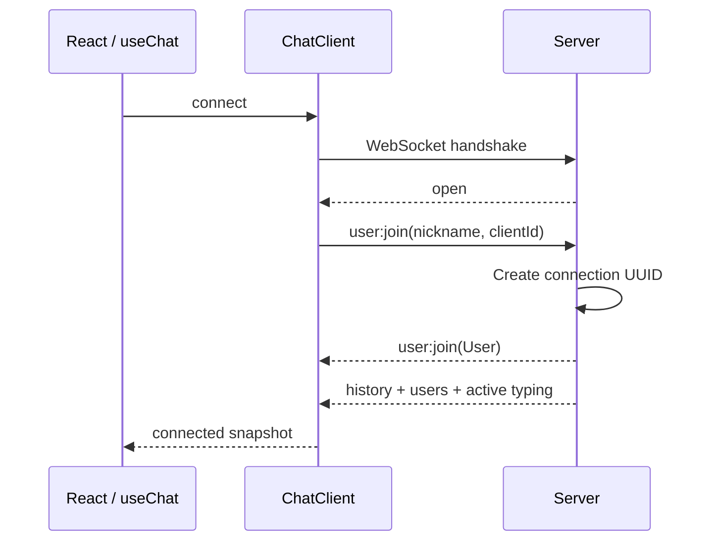
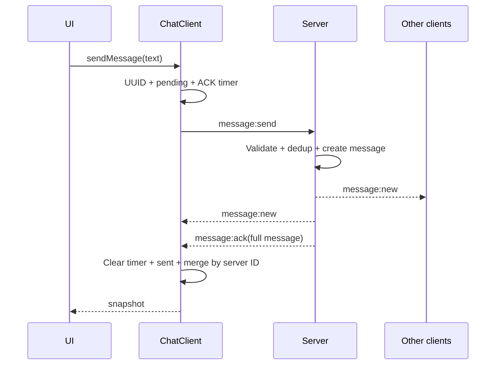

# Архитектура и учебный маршрут

## Порядок чтения

1. `packages/shared/src/index.ts`: типы событий, пределы и runtime-проверки.
2. `apps/server/src/server.ts` и `room.ts`: сборка сервера и состояние комнаты. Далее `transport/connection.ts`, `handlers/`, `store/messageStore.ts`, `services/typing.ts`: события и их обработка.
3. `apps/client/src/lib/ChatClient.ts`: транспорт, lifecycle и состояние; `DeliveryTracker.ts`: ACK-таймеры; `types.ts`: интерфейсы.
4. `apps/client/src/hooks/useChat.ts`: граница React и клиента.
5. `apps/client/src/App.tsx` и `components/ChatRoom.tsx`: композиция экранов. Далее UI-компоненты, `model/messageRows.ts` и `hooks/useMessageScroll.ts`.
6. Тесты рядом с кодом: штатные и ошибочные сценарии.

Сначала проследите message:send, затем ACK, retry и reconnect.

## Ответственность слоёв

| Слой       | Владеет                                          | Связь                                     |
| ---------- | ------------------------------------------------ | ----------------------------------------- |
| UI         | Nickname, черновик, прокрутка, панель участников | Методы клиента через hook                 |
| useChat    | Экземпляр, React effect и subscription           | Connect при mount, disconnect при cleanup |
| ChatClient | Socket, timers, snapshot, listeners              | ClientEvent → сеть → ServerEvent          |
| Server     | Peers, history, dedup, heartbeat                 | Validation, ID/время, broadcast           |
| Shared     | Контракты, пределы и type guards                 | Одинаковый протокол для обеих сторон      |

UI не создаёт WebSocket и не обрабатывает низкоуровневые события. Транспорт не зависит от React. Сервер назначает sender по зарегистрированному peer, а не доверяет отправителю из message payload.

## Типы и runtime

### Организация модулей после рефакторинга

`App` выбирает экран, `ChatRoom` связывает состояние и действия с компонентами. `LoginScreen` владеет формой входа; `MessageComposer` — черновиком. `UserSidebar`, `ChatHeader`, `MessageList`, `MessageItem` и `ErrorNotice` получают данные и callbacks через типизированные props. Эти компоненты не зависят от WebSocket-клиента.

`buildMessageRows` выполняет сверку серверных и исходящих сообщений отдельно от JSX. `useMessageScroll` управляет прокруткой и уведомлением о новых сообщениях. Общий CSS Module сохраняет единый внешний вид. Props, snapshot, payload и данные пользователей деструктурируются на границах компонентов и обработчиков. Методы ChatClient вызываются через экземпляр, чтобы сохранить `this`.

На backend `server.ts` создаёт listeners и отвечает за shutdown. `room.ts` связывает функции хранения, broadcast и typing. Обработчик соединения проверяет сетевой ввод и выбирает обработчик события; `handlers/join.ts` регистрирует пользователя, `handlers/message.ts` принимает сообщение и выдаёт ACK. `messageStore` назначает ID/время, хранит историю и проверяет dedup-key. Typing и heartbeat имеют отдельные модули с очисткой таймеров. Каждый сервер получает собственные коллекции и ресурсы.

### Проверка сетевых данных

ClientEvent и ServerEvent — отдельные discriminated unions. В switch поле type сужает payload. JSON.parse только разбирает JSON; результат остаётся unknown до вызова isClientEvent или isServerEvent. Проверяются направление события, структура, UUID, длина текста и каждый элемент массивов.

Ограничение кадра в ws дополняет ограничение текста: небольшой text не исключает огромный JSON с лишними полями. Бинарные кадры отклоняются отдельно.

## Регистрация и snapshot

Open означает только создание транспорта; connected наступает после подтверждения регистрации. Сервер хранит Map по WebSocket, каждый зарегистрированный peer имеет уникальный User ID. Одинаковые nickname допустимы.

GetSnapshot возвращает стабильную ссылку между обновлениями. Update создаёт новый объект и уведомляет listeners. Это контракт useSyncExternalStore. Subscribe возвращает функцию удаления listener; React вызывает её при cleanup.

UseMemo сохраняет экземпляр клиента до смены имени или URL. Конструктор не открывает соединение: это делает эффект. В Strict Mode setup → cleanup → setup закрывает первый сокет и создаёт следующий без параллельных активных подключений. Повторный connect на активном клиенте игнорируется. Callbacks проверяют принадлежность текущему сокету, поэтому запоздалое событие старого соединения не портит новое состояние.

## Путь сообщения

Pending хранится отдельно от серверной истории: у него нет серверного ID/времени. UI объединяет серверные записи и неподтверждённые исходящие. Когда появляется message:new, optimistic-копия скрывается по clientId/clientMessageId; delivery остаётся pending до ACK.

ACK переводит в sent и добавляет серверную запись, если её нет. AddMessage проверяет серверный id, поэтому повторные broadcast/ACK не создают новых пузырей. Таймер создаётся до send — даже синхронный тестовый ACK не оставит лишний timer. Через 5 секунд статус failed; поздний ACK всё ещё возвращает sent.

## Дедупликация и идентичность

- ClientId создаётся один раз экземпляром клиента и сохраняется между reconnect.
- ClientMessageId создаётся на одно сообщение и сохраняется при retry.
- Id назначает сервер принятому сообщению.
- SenderId идентифицирует одно подключение и меняется после reconnect.

Ключ accepted Map — clientId:clientMessageId. SenderId не подходит: он меняется. Nickname не подходит: имена могут совпадать. Уже принятый текст получает исходный ACK без broadcast. Изменённый текст/nickname с тем же ключом вызывает ID_CONFLICT.

История ограничена 1000, accepted — 5000 записями. Более широкое dedup-окно поддерживает retry недавно принятого сообщения, уже вышедшего из истории. Это гарантия в рамках текущей памяти процесса, а не постоянное exactly-once хранение.

## Reconnect и синхронизация

Unexpected close очищает online users, typing и ACK timers; pending становится failed. Текст остаётся для ручного retry. Один reconnect timer открывает новый сокет с exponential backoff и jitter. Регистрация сбрасывает attempt. Browser error показывает уведомление, а следующий close запускает reconnect. Тайм-аут handshake защищает от зависшего входа.

История после reconnect заменяет локальные серверные записи. Если сервер перезапустился, история клиента тоже очищается. Присутствие своего clientId/clientMessageId в истории доказывает принятие и переводит исходящее сообщение в sent даже без ACK. Автоматического retry нет.

## Typing

Первое изменение непустого черновика отправляет start. Refresh ограничен одним событием в секунду. Через 1.5 секунды без ввода, при очистке, отправке, blur или выходе отправляется stop.

Сервер рассылает start и обновления start, чтобы у получателей продлевался защитный тайм-аут при продолжительном вводе. Повторный start также обновляет серверный таймер. Через 3.5 секунды без refresh он рассылает stop. Disconnect очищает typing сразу. При join передаются текущие активные typing-состояния.

Клиент также имеет тайм-аут удалённых индикаторов: потерянный stop не оставляет надпись навсегда. Users:list удаляет индикаторы отсутствующих участников.

## Ресурсы и cleanup

| Ресурс               | Создаётся                                                   | Освобождается                           |
| -------------------- | ----------------------------------------------------------- | --------------------------------------- |
| Socket + callbacks   | Connect / reconnect                                         | Close / disconnect / detach             |
| Reconnect timer      | Неожиданный close / failed construction / handshake timeout | Следующая попытка / disconnect          |
| Handshake timer      | Создание сокета                                             | Join / close / disconnect / timeout     |
| ACK timers           | DispatchMessage                                             | ACK / failure / disconnect              |
| Local typing idle    | Изменение черновика                                         | StopTyping / close / disconnect         |
| Remote typing timers | Typing:start                                                | Stop / expiry / users:list / disconnect |
| React subscription   | UseSyncExternalStore                                        | Unsubscribe                             |
| Server join timer    | Connection                                                  | Join / close / shutdown                 |
| Server typing timer  | Typing:start                                                | Stop / close / shutdown                 |
| Heartbeat            | Создание сервера                                            | Server.close                            |

CreateChatServer возвращает close, освобождающий timers, сокеты и HTTP listener. Интеграционные тесты создают изолированный сервер и закрывают его в afterEach. Fake-timer тесты требуют отсутствия таймеров после cleanup.

## Границы и расширение

Nickname и clientId не защищают личность. Для публичного продукта нужны авторизация, Origin allowlist, rate limiting, ограничения подключений и persistence. ACK подтверждает принятие одним процессом, а не прочтение или устойчивое хранение.

Новую функцию начинайте с события shared и валидатора, затем добавляйте server handling, client state и UI. Для комнат понадобится room ID в регистрации, истории и dedup-key. Для persistence нужен уникальный ключ сообщения в хранилище и пересмотр момента выдачи ACK.

Перед изменением reconnect прочитайте fake-timer тесты, перед изменением протокола запустите реальные сетевые интеграционные тесты.
